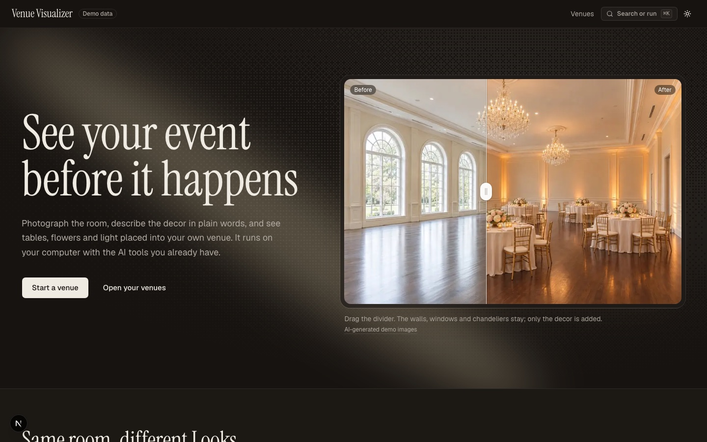
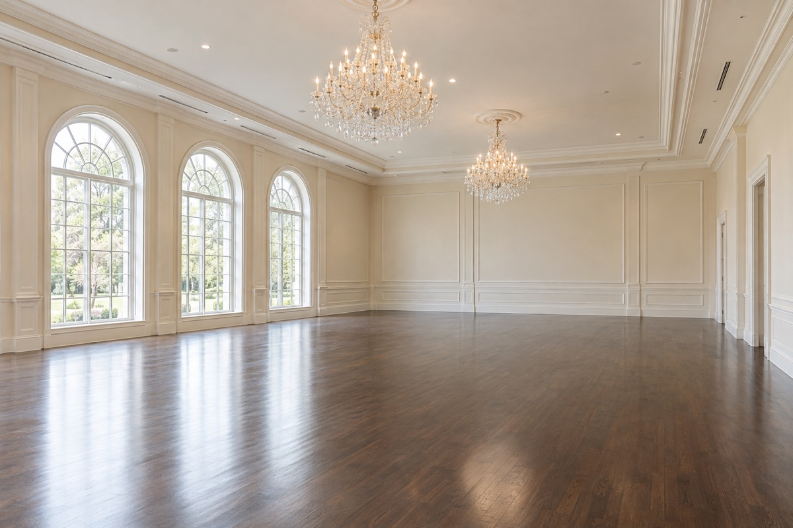
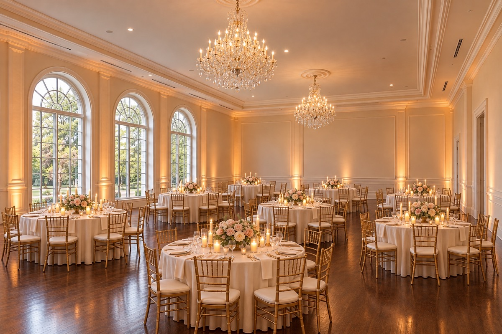
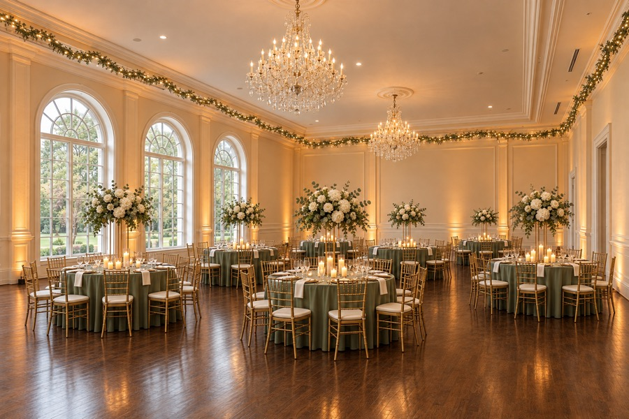
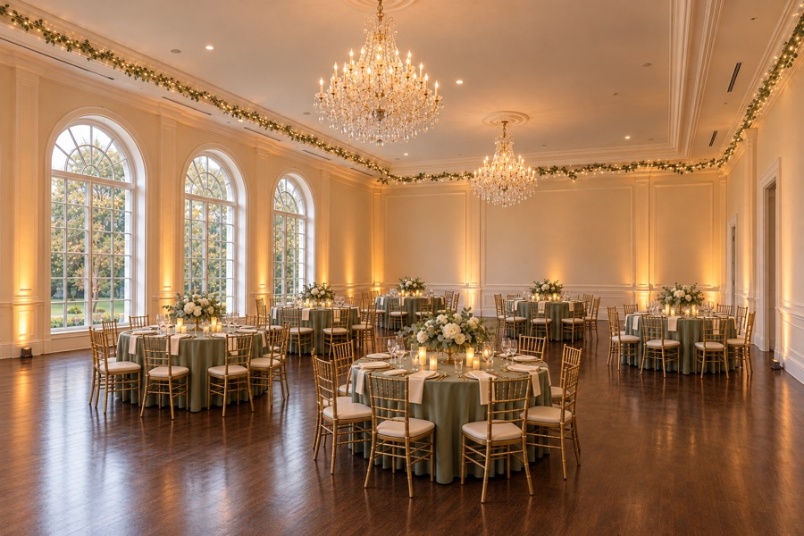
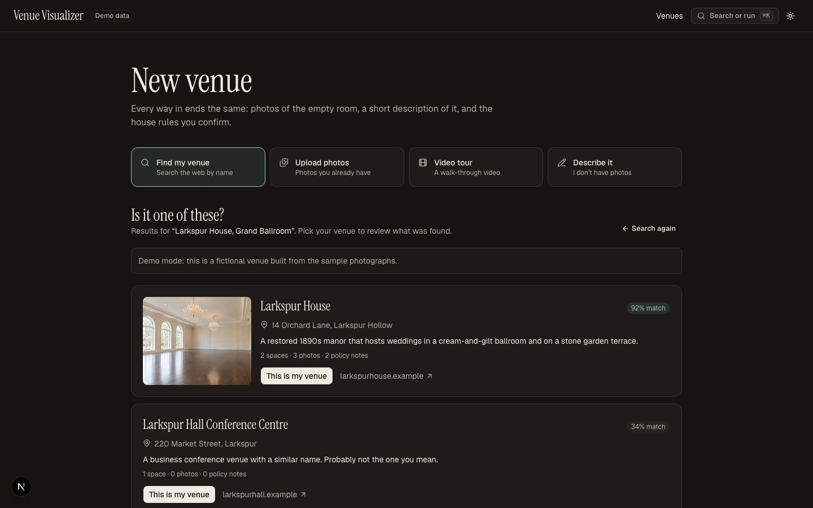
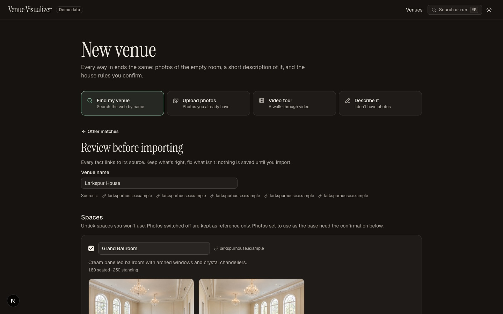
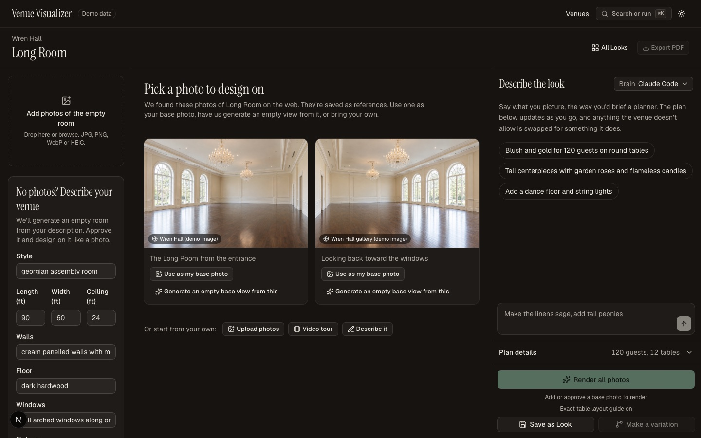
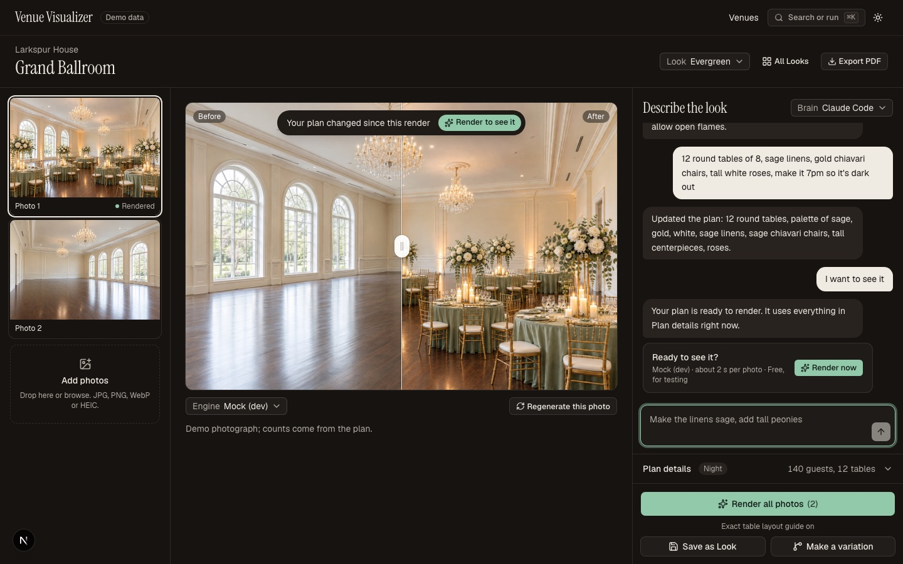
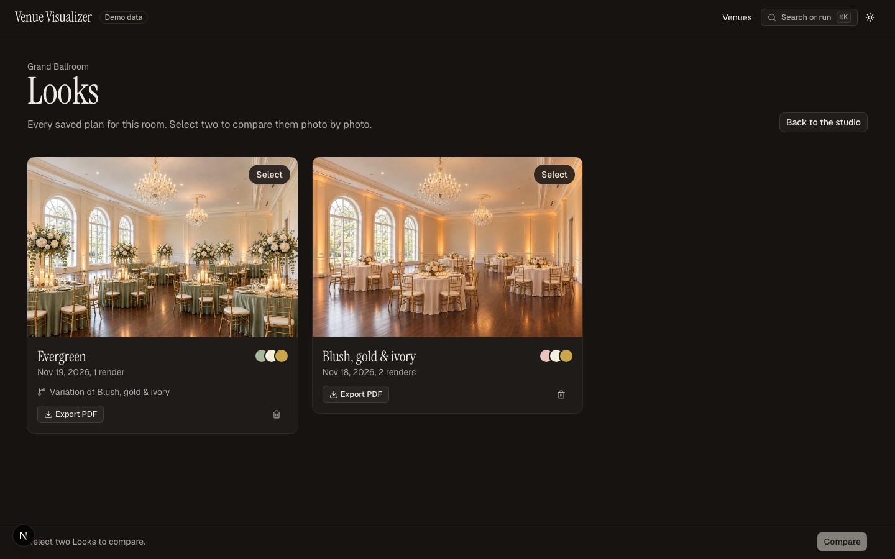

# Venue Visualizer

**See your event before it happens.** Bring your venue in (by name, photos, or a walkthrough video) and describe the
look you want in plain words. Venue Visualizer gives you back **photoreal pictures of your actual room**, with the
tables, linens, flowers and lighting in place. Compare Looks side by side and export a PDF for your florist or planner.

It runs on your computer and uses the AI tools **you're already subscribed to** (Claude Code, Codex, GitHub Copilot,
Kimi). There are no API keys and no per-image billing.



## Real results

Each render below came from the app's own pipeline. The photo went in, a chat message was turned into a design spec,
the venue rules were applied, and GitHub Copilot's image tool rendered the result from the **original photo**. The
walls, arched windows, chandeliers and floor stay put. Only the decor changes.

| The empty room | "12 rounds of 8, ivory and blush, gold chiavari, amber uplighting" | "Sage linens, tall white roses and eucalyptus in gold stands" | Same, with "low centerpieces" |
|---|---|---|---|
|  |  |  |  |

*The sample room is AI-generated, so no real venue is shown. Each render took about 50 seconds on a Copilot
subscription. Structure check scores were 0.86–0.93 (see [how the room is protected](#how-the-room-is-protected)).*

## Three ways to bring a venue in

**1. Find it by name.** An agent searches the web through your own CLI's web tools and collects the venue's spaces,
capacities, published decor policies and photos. Every fact links to its source, and nothing is saved until you
review it.

| Search results | Review before importing |
|---|---|
|  |  |

Policies found online, such as "no confetti", are only *suggestions* until you tick them. Photos from the web are
credited, and they're only used as an editable base once you confirm they're for your personal planning. Otherwise they
stay as references, and you can turn one into a base photo or generate an empty view of that room from it later:



**2. Upload photos** you already have (5–30 per space; phone JPEG, HEIC, PNG and WebP all work).

**3. Upload a walkthrough video.** ffmpeg picks the sharpest, most varied frames. A vision-capable brain labels each
frame and splits a multi-room tour into spaces ("Grand Ballroom: 8 frames, Terrace: 4 frames"). Every kept frame then
works like an uploaded photo.

No photos at all? Describe the room, and the app generates an empty base view for you to approve first.

## Design by chatting



- **Plain-language changes.** "12 round tables of 8, sage linens… make it 7pm so it's dark out" updates the plan.
  The *Plan details* form shows every field (tables, linens, chairs, centerpieces, lighting, time & windows) and
  stays editable.
- **Venue rules are enforced in code, not by the AI.** "Live taper candles and fog for the first dance" becomes
  flameless candles and no fog, and the reply tells you so. The rules only come from what you enter or accept.
- **"I want to see it"** brings up a one-click **Render now** card. If the plan changed since the picture on screen,
  a banner says so.
- **Looks.** Save Looks, make variations, compare two side by side, and export a PDF with the spec in plain
  sentences, the renders and photo credits.



## Bring your own AI: no API keys

| Used for | Works with (any one is enough) |
|---|---|
| Understanding requests, chat, venue research, video understanding | Claude Code · Codex CLI · GitHub Copilot CLI · Kimi Code CLI |
| Photoreal images | GitHub Copilot CLI image tool · Codex CLI `$imagegen` · local FLUX via mflux (Apple Silicon, free) |

- The app only spawns the vendors' official CLIs. It never reads their credentials or calls vendor APIs directly.
- Every CLI is started **without** `*_API_KEY` variables, so nothing silently switches to per-token billing.
- Because it uses *your* subscriptions, it is meant to run locally, not as a hosted service.

## How the room is protected

Image models sometimes move windows or drop chandeliers, so every render is checked:

1. The render is **aligned to your photo** (SIFT + RANSAC). Engines return 3:2 images even for 4:3 phone photos, so
   naive comparison would be wrong.
2. Architectural edges in the upper 40% of the frame (ceiling, windows, upper walls) are compared **globally and per
   tile**, so one missing chandelier can't hide behind an intact ceiling.
3. A different room or angle, a flipped image, a blank render or a heavy crop **can't pass**. Each fails alignment
   and is capped below the threshold.
4. When a table count matters, an internal 3D **layout guide** shows the model exactly where 12 tables go.
   You never see the guide, only the photoreal result.

The thresholds were calibrated on real renders and on adversarial edits. The numbers are in
[docs/decisions.md](docs/decisions.md).

## Setup

Requirements: macOS or Linux, Node 22+, pnpm 10+, Python 3.11+, [uv](https://docs.astral.sh/uv/), ffmpeg (for video
tours), and at least one of the CLIs above, installed and logged in.

```bash
git clone https://github.com/Bakar404/venue-visualizer.git && cd venue-visualizer
cp .env.example .env                 # optional overrides; no keys needed
make setup                           # uv sync + pnpm install
cd services && uv sync --extra scene3d && uv run playwright install chromium && cd ..   # optional: exact table layouts
make dev                             # API :8000, worker, web :3000
```

Open http://localhost:3000. The landing page lists the brains and image engines it detected.

To try the UI with no CLIs at all, run it with demo data:

```bash
NEXT_PUBLIC_VV_MOCK=1 pnpm dev:web
```

## Tests and proof

The project is built **proof-driven**. Every bug found in user testing or code review gets a test first, and that test
is run against the unfixed code. Its failing output is kept as evidence (`docs/proof/*-red.txt`), then the fix lands
and the same test passes (`*-green.txt`, with screenshots for UI changes).

```bash
make test                                   # Python: 250+ tests (pipeline, API, structure check, rules)
pnpm --filter web exec vitest run           # web unit tests
pnpm --filter web e2e                       # Playwright end-to-end tests (mock mode, desktop + mobile)
SHOTS=1 pnpm --filter web exec playwright test e2e/readme-shots.spec.ts --project=chromium   # regenerate README screenshots
```

- [docs/user-testing/](docs/user-testing/): real user sessions turned into findings and acceptance tests
- [docs/proof/](docs/proof/): red → green evidence for each fix
- [docs/decisions.md](docs/decisions.md): every design decision and why
- [docs/architecture.md](docs/architecture.md) and [docs/api.md](docs/api.md): how it fits together

## Project layout

```
apps/web            Next.js app: studio, venue finder, video review, compare, export
services/api        FastAPI + SQLite job queue + worker
services/pipeline   brains (CLI LLMs), image engines (CLI image tools), rules, prompts, video, research, safe fetch, verify
packages/schema     JSON Schemas (DesignSpec, VenueSpec, VenueResearch): source of truth, plus generated TS types
packages/scene      internal layout-guide renderer (React Three Fiber)
docs/               architecture, API, decisions, user testing, proof, images
```

## Privacy and content

- Everything stays on your machine in `data/` (gitignored). Uploads have EXIF/GPS stripped.
- The local API only answers to localhost and rejects cross-site writes, so other websites can't spend your quota.
- Web photos keep their source credit and are for personal planning. PDF exports print the credits.

## Frameworks and libraries

**Frontend (`apps/web`)**

| What | Used for |
|---|---|
| [Next.js](https://nextjs.org/) 16 (App Router) + [React](https://react.dev/) 19 + TypeScript 6 | the app |
| [Tailwind CSS](https://tailwindcss.com/) 4 + [tw-animate-css](https://github.com/Wombosvideo/tw-animate-css) | styling and tokens, light and dark themes |
| [shadcn/ui](https://ui.shadcn.com/) on [Base UI](https://base-ui.com/) | component structure and accessible primitives |
| [Sonner](https://sonner.emilkowal.ski/) | toasts |
| [cmdk](https://github.com/dip/cmdk) | the ⌘K command palette |
| [NumberFlow](https://number-flow.barvian.me/) | animated counts and progress |
| [Motion](https://motion.dev/) | animation, following [emilkowalski/skills](https://github.com/emilkowalski/skills) (vendored in `.claude/skills`) |
| [TanStack Query](https://tanstack.com/query) | data fetching and job polling |
| [React Hook Form](https://react-hook-form.com/) + [Zod](https://zod.dev/) | the spec form and validation |
| [next-themes](https://github.com/pacocoursey/next-themes), [Lucide](https://lucide.dev/) | theme switching, icons |
| [three.js](https://threejs.org/) + [React Three Fiber](https://r3f.docs.pmnd.rs/) + [drei](https://github.com/pmndrs/drei) | the internal layout-guide renderer (`packages/scene`) |
| [Vitest](https://vitest.dev/) + Testing Library, [Playwright](https://playwright.dev/) | unit and end-to-end tests, README screenshots |

Design references: [Aceternity UI](https://ui.aceternity.com/) (spotlight hero), [21st.dev](https://21st.dev) (cards),
[Beautiful UI](https://www.beautifului.dev/) (layout and typography), [RareUI](https://rareui.in/) (accents),
[CUI](https://yappologistic.github.io/CUI/) (the dithered background).

**Backend (`services/`)**

| What | Used for |
|---|---|
| [FastAPI](https://fastapi.tiangolo.com/) + [Uvicorn](https://www.uvicorn.org/) | HTTP API |
| [SQLModel](https://sqlmodel.tiangolo.com/) / [Pydantic](https://docs.pydantic.dev/) 2 + SQLite (WAL) | data and validation, the durable job queue |
| [OpenCV](https://opencv.org/) + [scikit-image](https://scikit-image.org/) + NumPy | structure check (SIFT alignment, edge comparison), video frame scoring |
| [Pillow](https://python-pillow.org/) + [pillow-heif](https://github.com/bigcat88/pillow_heif) | image decoding, HEIC, EXIF stripping |
| [FFmpeg](https://ffmpeg.org/) | video tour frame extraction |
| [httpx](https://www.python-httpx.org/) | SSRF-safe image downloads and link checks |
| [jsonschema](https://python-jsonschema.readthedocs.io/) | validating AI output against the shared schemas |
| [ReportLab](https://www.reportlab.com/) | PDF export |
| [Playwright for Python](https://playwright.dev/python/) | headless rendering of the layout guide |
| [pytest](https://pytest.org/) + [Ruff](https://docs.astral.sh/ruff/) + [uv](https://docs.astral.sh/uv/) | tests, lint, environment |

**AI (through each vendor's official CLI, on your subscription)**: [Claude Code](https://claude.com/claude-code),
[OpenAI Codex CLI](https://github.com/openai/codex), [GitHub Copilot CLI](https://github.com/features/copilot/cli)
(including its image tool), [Kimi Code](https://www.kimi.com/code), and [mflux](https://github.com/mflux-community/mflux)
for local FLUX on Apple Silicon.
